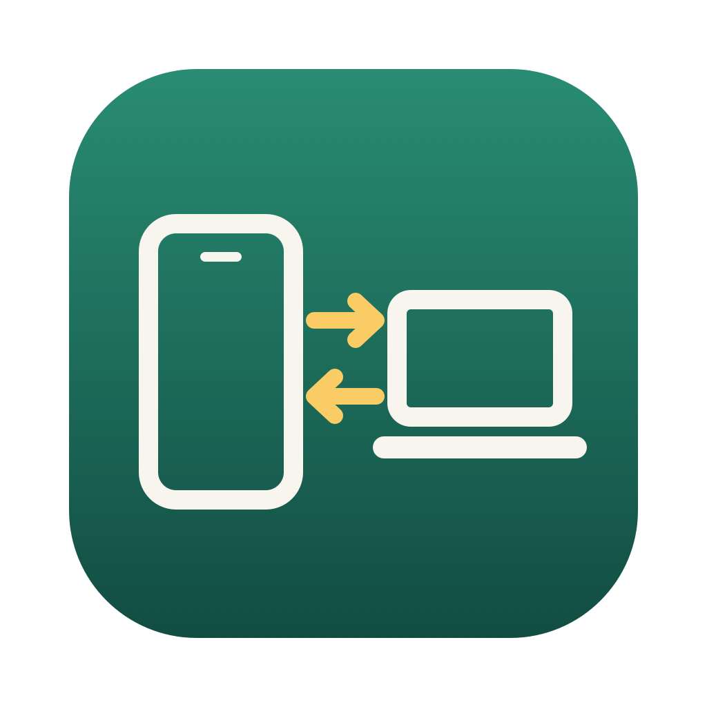
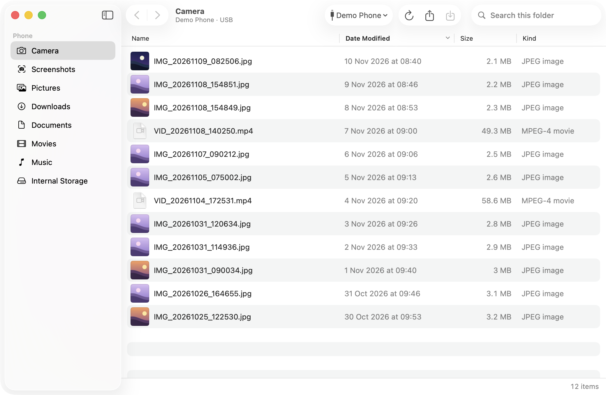
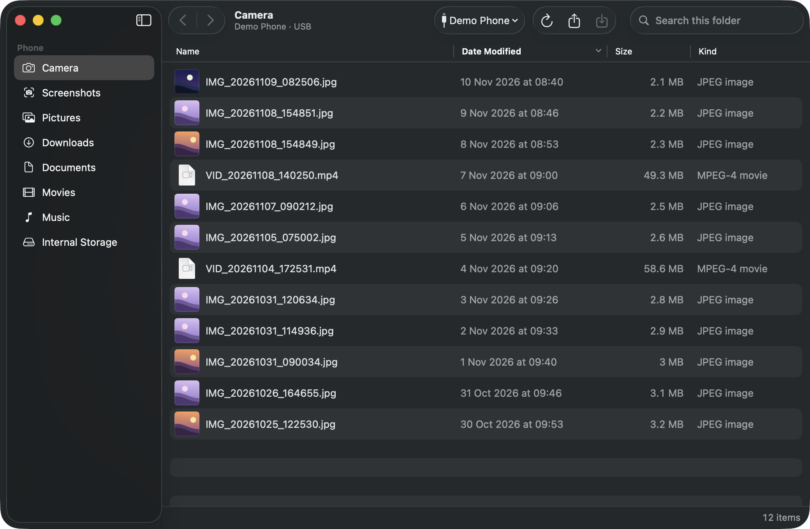
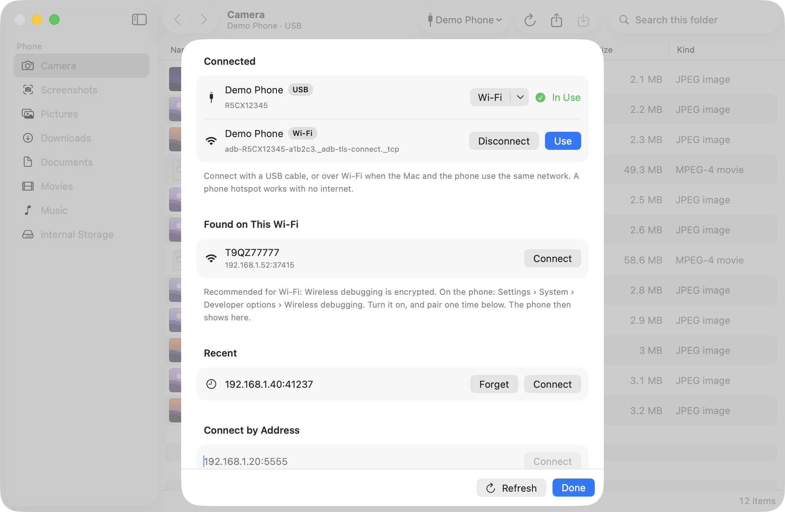

<p align="center">
  
</p>

<h1 align="center">DroidDock</h1>

<p align="center">
  A native Mac app to copy files between your Android phone and your Mac.<br>
  Over USB or Wi-Fi. No internet, no account, no MTP.
</p>

<p align="center">
  <a href="https://github.com/bsharif/droiddock/releases/latest"></a>
  <a href="https://github.com/bsharif/droiddock/actions/workflows/build.yml"></a>
  
  <a href="LICENSE"></a>
</p>



## Why

macOS has no built-in way to browse an Android phone. MTP apps often cannot see the phone,
because macOS Image Capture takes the USB connection first. DroidDock uses **adb** (Android
Debug Bridge) instead. adb is fast and reliable, and it also works over Wi-Fi.

## Features

- **Finder-style browser** for the phone: sidebar with Camera, Screenshots, Downloads and more,
  a sortable table, back and forward, and search.
- **Photo thumbnails.** DroidDock reads only the small preview inside each JPEG (about 64 KB),
  so large camera folders stay fast.
- **Copy to Mac** with a button, a right-click, or a double-click (copy and open).
- **Send to phone** by dragging files from Finder onto the window, or with **Send to Phone…**.
- **USB or Wi-Fi.** A phone picker opens at startup. It shows USB phones, phones that are found
  on your Wi-Fi, and recent addresses. You can pair a new phone with a code.
- **Works with no internet.** Use a cable, or your phone's hotspot.
- Light and dark mode, keyboard shortcuts, and a Settings window.

| Dark mode | Phone picker |
|---|---|
|  |  |

*Screenshots use demo data.*

## Install

1. Install adb with [Homebrew](https://brew.sh):
   ```bash
   brew install android-platform-tools
   ```
2. Download `DroidDock-vX.Y.Z-macos.zip` from the
   [latest release](https://github.com/bsharif/droiddock/releases/latest).
3. Unzip it, and move **DroidDock.app** to your Applications folder.
4. The app is not notarised by Apple. The first time, macOS blocks it. To open it:
   - Open DroidDock one time, and close the warning.
   - Open **System Settings › Privacy & Security**, and click **Open Anyway** next to DroidDock.

   Or, in Terminal:
   ```bash
   xattr -dr com.apple.quarantine /Applications/DroidDock.app
   ```

**Needs:** macOS 14 Sonoma or later, on Apple Silicon or Intel.

## Set up your phone (one time)

1. On the phone, open **Settings › About phone**, and tap **Build number** 7 times.
2. Open **Settings › System › Developer options**, and turn on **USB debugging**.
3. Connect the cable. On the phone, select **Always allow from this computer**, then tap **Allow**.

The menu names can be different on some phones.

## Wi-Fi

**Recommended: Wireless debugging (Android 11 and later).** This connection is encrypted.

1. On the phone, open **Developer options › Wireless debugging**, and turn it on.
2. Tap **Pair device with pairing code**.
3. In DroidDock, open the phone picker (⌘K). Under **Pair a New Phone**, type the address and code
   that the phone shows. You pair one time only.
4. After that, the phone shows under **Found on This Wi-Fi** when Wireless debugging is on.

The Mac and the phone must use the same network. A phone hotspot works, with no internet.

> [!WARNING]
> **Unencrypted Wi-Fi (port 5555).** For a USB phone, the **Wi-Fi** button can turn on classic
> adb over Wi-Fi on port 5555. This mode is **not encrypted**. Another device on the same network
> can capture the files that you copy. Use it only on a network you own, such as your phone's
> hotspot. DroidDock asks you to confirm, and marks the connection **Wi-Fi, unencrypted**.
> To close port 5555, click **Turn Off**, or restart the phone.

## Keyboard shortcuts

| Action | Keys |
|---|---|
| Choose phone | ⌘K |
| Copy to Mac | ⌘D |
| Send to phone | ⌘O |
| Refresh | ⌘R |
| Back / Forward | ⌘[ / ⌘] |
| Enclosing folder | ⌘↑ |
| Sidebar places | ⌥⌘1 … ⌥⌘8 |
| Show photo thumbnails | ⌥⌘T |
| Settings | ⌘, |

Copied files go to `~/Downloads/DroidDock`. You can change this in Settings.

## Privacy

- DroidDock talks only to your phone, through adb on your Mac. It sends no data to the internet.
- There is no account, analytics or tracking.
- Thumbnails are kept in `~/Library/Caches/DroidDock`. Recent Wi-Fi addresses are kept in
  `~/Library/Application Support/DroidDock`.

## Troubleshooting

| Problem | Fix |
|---|---|
| "adb is not installed" | Run `brew install android-platform-tools`. |
| Phone says "unauthorised" | Unlock the phone, and tap **Allow** on the USB debugging prompt. |
| No phone shows on USB | Try another cable. Some cables only charge. |
| Wi-Fi phone not found | Check that both use the same network, and that Wireless debugging is on. |
| macOS asks about the local network | Click **Allow**. DroidDock needs it to find phones on Wi-Fi. |

## Build from source

Needs Xcode command-line tools (Swift 5.9 or later) and Rust.

```bash
git clone https://github.com/bsharif/droiddock.git
cd droiddock
./packaging/build-app.sh --install
```

Options: `--zip` makes a release zip. `UNIVERSAL=1` builds for Apple Silicon and Intel (needs
`rustup target add aarch64-apple-darwin x86_64-apple-darwin`).

## How it works

```
DroidDock.app
├── DroidDock          SwiftUI app: window, table, sheets, thumbnails
└── droiddock-engine   Rust command-line engine: runs adb, returns JSON
```

The SwiftUI app runs the engine for each action, for example
`droiddock-engine ls <serial> /sdcard/DCIM/Camera`. The engine replies with one JSON object.
All adb work is in [`src/main.rs`](src/main.rs). The interface is in [`macos/`](macos).

`packaging/demo/` has a fake engine for screenshots. To use it, copy it to a folder outside
Documents, Desktop and Downloads (macOS privacy protection blocks those for the app), then set
`DROIDDOCK_ENGINE` to its path.

## Versions

DroidDock uses [Semantic Versioning](https://semver.org). Changes are in
[CHANGELOG.md](CHANGELOG.md). To make a release, change `version` in `Cargo.toml`, add a
CHANGELOG entry, then push a tag such as `v0.2.0`. GitHub Actions builds the app and publishes
the release.

## Licence

[MIT](LICENSE). DroidDock is not affiliated with Google. Android is a trademark of Google LLC.
